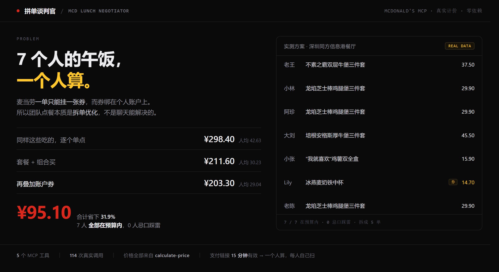

# 拼单谈判官 · MCD Lunch Negotiator



> 一个人算，七个人各自扫码。基于**麦当劳官方 MCP** 的团队午餐拆单优化引擎。

**7 个人的真实一顿**（麦当劳深圳同方信息港餐厅，2026-10-24 实跑，金额全部来自官方 `calculate-price` 接口）

| 方案 | 合计 | 人均 |
|---|---|---|
| 同样这些吃的，逐个单点买 | ¥298.40 | ¥42.63 |
| **本工具给出的方案** | **¥211.60** | **¥30.23** |
| 叠加账户券后（实际要付） | **¥203.30** | ¥29.04 |

**比乱点省 ¥95.10（31.9%）；7 个人全部在预算内；0 个人踩到忌口；拆成 5 单。**

一次完整方案 = **114 次真实 MCP 调用**，零第三方依赖。

```bash
git clone https://github.com/bihumanbu/mcd-lunch-negotiator
cd mcd-lunch-negotiator
export MCD_MCP_TOKEN=你的Token            # 申请：https://open.mcd.cn/mcp
python src/preflight.py                   # 可选：30 秒自检 Token / 连通性 / 文件完整性
python src/negotiator.py 深圳 科技园      # 城市 + 门店关键词，两个都必须传
```

不想跑？**一页看完** → [`docs/pitch.html`](./docs/pitch.html)　｜　**完整输出存档** → [`docs/sample-plan.md`](./docs/sample-plan.md)

---

## 为什么值得做：两道没人正眼看过的墙

麦当劳的优惠体系有两道硬约束：

1. **一单只能用一张券**，而券绑定在个人账户上；
2. **套餐和单点的价差**，官方从不直接告诉你。

所以「7 个人一起点午饭」本质上不是聊天能解决的问题，而是一个**拆单 + 选品 + 计价**的组合优化问题：

- 谁该买套餐，谁该单点
- 哪几个人可以合并成一单，**哪几个人必须拆开**（有券的人独占一单，合并等于白扔券）
- 哪张券该挂在哪一单上
- 每个人的预算约束怎么同时满足

GitHub 上已有的 100+ 个麦当劳 MCP 项目**几乎全部是单人视角**——帮你一个人省钱、算卡路里。而办公室午饭是更高频、更痛、而且**真的有一个人每天在干这件事**的场景：那个负责点单的人。

这个项目就是给那个人用的。

---

## 目标用户

| 用户 | 场景 | 痛点 |
|---|---|---|
| **办公室「点单担当」** | 每天中午统计 5—10 人想吃什么、收钱、点单 | 手动凑单，总是算错，还容易漏掉有人不吃辣 |
| **小组长 / 行政** | 团建、加班餐、会议餐 | 预算卡死，不知道怎么在预算内让所有人满意 |
| **麦当劳重度用户** | 一个人点，但想吃得更划算 | 不知道套餐到底比单点省多少 |

---

## 它到底做什么

```
一群人 + 门店
      ↓
query-nearby-stores   解析真实门店（拿到 storeCode，所有后续调用的前提）
      ↓
query-meals           拉门店菜单目录（只返回 code + tags）
      ↓
query-meal-detail     逐个解剖候选套餐：几个轮次、默认选项是什么、加价多少
      ↓
calculate-price       对每个候选做官方实时计价（返回「分」）
      ↓
组合求解              每人预算/口味/忌口约束下选品 → 输出方案
      ↓
拆单清单              哪些人合并一单、每单挂什么、实付多少
```

**核心输出四块：**

1. **每人买法**——谁吃什么，实付多少，是否满足忌口和预算
2. **省钱对照**——把套餐默认内容逐个单点计价，和套餐价对比，给出真实差额
3. **拆单清单**——怎么下单，谁跟谁合并
4. **调用审计**——本次共调用了多少次 MCP，全部可复现

---

## 快速开始

### 1. 申请 MCP Token

访问 [open.mcd.cn/mcp](https://open.mcd.cn/mcp) → 手机号登录 → 控制台 → 激活 → 复制 Token。

> Token 绑定你的麦当劳会员账号，**不要提交到任何仓库**。

### 2. 配置凭据（二选一）

**方式 A：环境变量（推荐）**

```bash
export MCD_MCP_TOKEN="your_token_here"      # Linux / macOS
setx MCD_MCP_TOKEN "your_token_here"        # Windows
```

**方式 B：私有凭据文件**

```bash
mkdir -p ~/.workbuddy/credentials
echo '{"token":"your_token_here"}' > ~/.workbuddy/credentials/mcd-mcp.json
```

### 3. 运行

```bash
git clone https://github.com/bihumanbu/mcd-lunch-negotiator.git
cd mcd-lunch-negotiator

# 无第三方依赖，Python 3.8+ 即可
python src/negotiator.py 深圳 科技园
```

第一个参数是城市，第二个是门店关键词（两个都必须传，原因见 [MCP_INTEGRATION.md](./MCP_INTEGRATION.md#坑-1城市和关键词必须同时传)）。

### 4. 查看结果

结果同时输出到终端和 `plan.md`。

> **不想跑也能看**：完整输出已存档在 [`docs/sample-plan.md`](./docs/sample-plan.md)，就是下面这些数字的原文。
>
> **想复现「114 次真实调用」这个数字**：先清空 `data/` 目录再跑。带缓存时只会新增十几次调用，末尾会自动注明缓存命中数，不会含糊。

---

## 使用示例

### 真实运行结果（2026-10-24，麦当劳深圳同方信息港餐厅）

```bash
$ python src/negotiator.py 深圳 科技园
```

**门店**：麦当劳深圳同方信息港餐厅（storeCode 1420762）

#### 核心结论

| 方案 | 合计 | 人均 |
|---|---|---|
| 同样这些吃的，逐个单点买 | ¥298.40 | ¥42.63 |
| **拼单谈判官（套餐 + 组合）** | **¥211.60** | **¥30.23** |

> **同内容省 ¥86.80，人均省 ¥12.40（29.1%）**
> 约束达成：**7/7 人在预算内**，**0 人忌口踩雷**

再叠加账户里的券：Lily 的「冰燕麦奶铁中杯」原价 ¥23.00，挂「中杯奶铁 7 折」券后 **¥14.70**，再省 ¥8.30，**最终合计 ¥203.30**。

#### 每人买法

| 人 | 预算 | 推荐 | 实付 | 约束 |
|---|---|---|---|---|
| 老王 | ¥40 | 不素之霸双层牛堡三件套 | ¥37.50 | 避鸡肉 |
| 小林 | ¥30 | 龙焰芝士棒鸡腿堡三件套 | ¥29.90 | 减脂 |
| 阿珍 | ¥35 | 龙焰芝士棒鸡腿堡三件套 | ¥29.90 | 避牛肉 |
| 大刘 | ¥50 | 培根安格斯厚牛堡三件套 | ¥45.50 | — |
| 小张 | ¥25 | “我就喜欢”鸡薯双全盒 | ¥15.90 | — |
| Lily | ¥40 | 冰燕麦奶铁中杯 | ¥23.00 → ¥14.70（挂券） | 咖啡 |
| 老陈 | ¥32 | 龙焰芝士棒鸡腿堡三件套 | ¥29.90 | — |

#### 逐项省钱对照（官方计价实测）

| 套餐 | 套餐价 | 同内容单点 | 差额 |
|---|---|---|---|
| 不素之霸双层牛堡三件套 | ¥37.50 | ¥50.00 | **省 ¥12.50** |
| 龙焰芝士棒鸡腿堡三件套 | ¥29.90 | ¥50.50 | **省 ¥20.60** |
| 培根安格斯厚牛堡三件套 | ¥45.50 | ¥58.00 | **省 ¥12.50** |

> 注：套餐里的「可乐中杯」不单独售卖（单点计价返回 0），按同档位可单点商品「雪碧中杯」¥10.00 保守估值——这是**下限**，不是虚高。

#### 拆单清单

```
第 1 单  不素之霸双层牛堡三件套 × 1   老王              ¥37.50
第 2 单  龙焰芝士棒鸡腿堡三件套    × 3   小林、阿珍、老陈   ¥89.70
第 3 单  培根安格斯厚牛堡三件套     × 1   大刘              ¥45.50
第 4 单  “我就喜欢”鸡薯双全盒      × 1   小张              ¥15.90
第 5 单  冰燕麦奶铁中杯（挂券）      × 1   Lily              ¥14.70
```

**共 5 单，合计 ¥203.30。**

### 自定义人群

编辑 `src/negotiator.py` 里的 `PEOPLE_DEFAULT`：

```python
PEOPLE_DEFAULT = [
    {"name": "老王", "budget": 40, "want": ["汉堡"], "avoid": ["鸡肉"]},
    {"name": "小林", "budget": 30, "want": ["鸡肉"], "light": True},
    {"name": "Lily", "budget": 40, "want": ["咖啡"]},
]
```

字段含义：

| 字段 | 说明 |
|---|---|
| `budget` | 预算上限（元），超出会被过滤 |
| `want` | 想吃的分类，可选：`汉堡` / `鸡肉` / `牛` / `咖啡` / `小食` / `清淡` |
| `avoid` | 忌口，命中直接排除 |
| `light` | 减脂模式，优先 500 大卡以下分类 |

---

## 项目结构

```
mcd-lunch-negotiator/
├── README.md                  # 本文件
├── MCP_INTEGRATION.md         # MCP 接入说明与踩坑记录（核心文档）
├── CONTEST_DECLARATION.md     # 参赛声明（官方原样，不可改动）
├── workbuddy.md               # 使用 WorkBuddy 开发的对话上下文
├── src/
│   ├── mcd_client.py          # MCP 客户端：线程安全、重试、三形态响应解析
│   ├── negotiator.py          # 拼单引擎（选品 / 并发计价 / 拆单 / 券匹配）
│   ├── explore.py             # 数据探索脚本（调试用）
│   └── probe.py               # 连通性探针（调试用）
├── skill/                     # WorkBuddy Skill 封装（可独立安装）
│   └── SKILL.md
├── docs/
│   ├── mcp-tools.json         # 35 个 MCP Tool 的真实清单快照
│   └── demo-script.md         # 3 分钟演示口播稿
├── data/cache_*.json          # 详情与价格磁盘缓存（不入库）
└── data_scan.json             # 一次真实全量扫描的落盘数据
```

---

## 已知限制

诚实地写在这里，因为这几条都是真实踩到的：

1. **不做自动支付**。`create-order` 已实测可返回 `payH5Url`，但产品主流程不调用它；支付由人扫码完成——这是安全边界，不是能力缺失。
2. **订单只有 15 分钟生命**。实测 `create-order` 返回的 `expirePayTime` 是创建时间 +15 分钟。所以拆单不能贪多，链接必须分给对应的人各自扫，一个人连扫 5 单来不及。
3. **不支持多账户 Token**。券绑定个人账户，跨账户管理在规则上和技术上都不成立。本项目的定位是「一个人的账号替全组点单」。
4. **菜单不能全量拉取**。115 个 SKU 全部补详情会触发限流，必须先按分类筛候选。
5. **批量计价遇无效 SKU 会整单归零**（返回 0 而不是报错），必须逐个校验。
6. **套餐专属 SKU 的单点价是 0**。可乐中杯这类商品不单卖，`calculate-price` 返回 0 而非报错。直接求和会把「单点对照」算低，必须用同档位商品估值并标注。
7. **营养数据是 TOON 文本格式**，不是 JSON，需要单独解析。
8. **首次运行慢**。约 114 次真实调用，单次延迟 4—5 秒，靠 8 线程并发压到 72 秒；之后走磁盘缓存，10 秒内出结果。

详见 [MCP_INTEGRATION.md](./MCP_INTEGRATION.md)。

---

## 安全与合规

- Token 只从环境变量或私有凭据文件读取，**代码中无任何硬编码凭据**
- 仓库内所有配置文件均使用占位符
- 不采集、不上传任何用户个人信息
- **`src/test_order.py` 是写操作探针，不要随便跑**：它会真实创建一笔订单（随后立即调用 `cancel-order` 取消），运行前请确认是你自己的账号和门店
- 下单证据存档在 [`docs/order-probe.json`](./docs/order-probe.json)，**账号 ID、订单号、payId 均已脱敏**
- 不自动下单、不自动支付，所有写操作需人工确认
- 餐品信息、价格及供应状态以麦当劳官方渠道实时结果为准

本项目为麦当劳程序员节创意开发大赛参赛作品，由参赛者独立开发，**非麦当劳官方产品**。

---

## 技术栈

- Python 3.8+（仅标准库，零第三方依赖）
- McDonald's MCP Server `mcd-mcp v1.0.0`（JSON-RPC over HTTP，无状态）
- 开发环境：WorkBuddy Skill

## License

MIT
